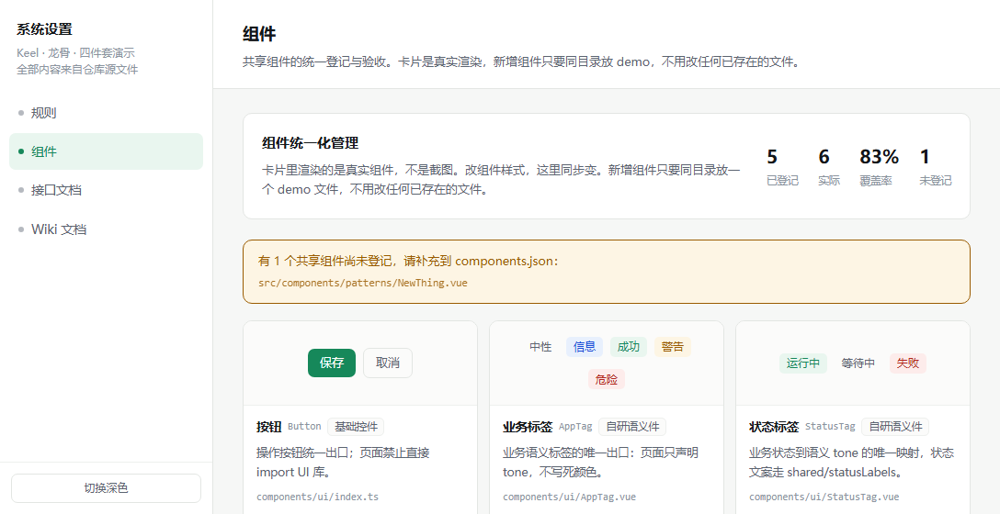
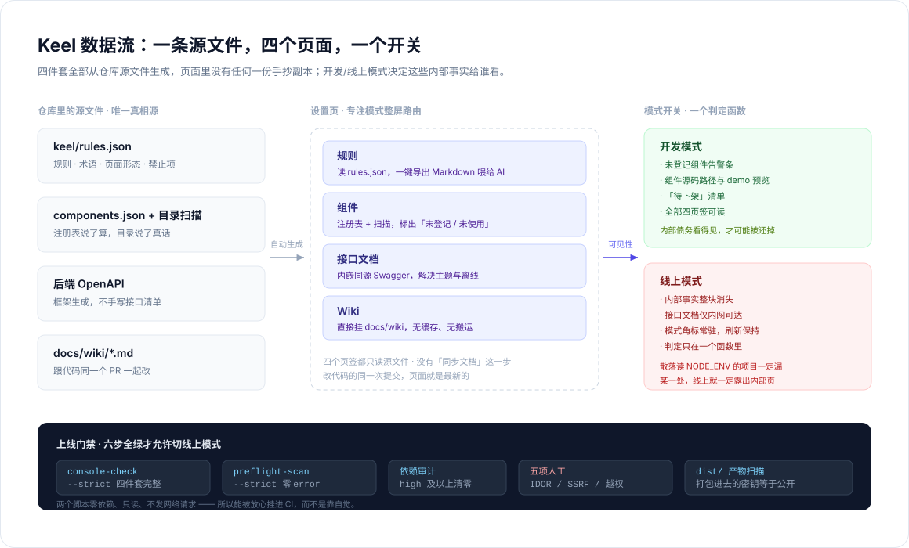

# Keel · 龙骨

### 你的内部文档，活不过三个月。

不是因为你懒。是因为它本来就是**第二份**——代码改一次，它得跟着改一次，而没有人会记得。

问题从来不是写文档慢，是**同一件事被写了两遍**。第一遍在代码里，第二遍在没有人的待办里。

Keel 把这四页改成直接读仓库里的那一份源文件。**没有副本，就没有过期。**

中文 · [English](README.en.md)

<p>
  <a href="https://github.com/Chaierss/keel/actions/workflows/validate.yml"></a>
  <a href="LICENSE"></a>
  <a href="package.json"></a>
  <a href="package.json"></a>
  <a href="https://www.chaierss.fun"></a>
</p>

<p></p>

<sub>同一个页面，两拨读者。给内部人看时，那个还没登记的组件、以及它躺在哪个文件里都在；对外时这些整体消失——页面还是那个页面，代码还是那份代码。<b>让它消失的不是开关，是构建期剔除和接口鉴权。</b></sub>

## 30 秒，什么都不用装

**看效果** → [打开在线演示](https://chaierss.github.io/keel/skills/keel/templates/preview/console-demo.html)，右下角对照「完整视角 / 对外视角」。那个开关是演示专用的，真实项目里不该有。想离线看也行：[下载单文件](skills/keel/templates/preview/console-demo.html) 双击即开，断网可用。

**量项目** → 只读，只告诉你缺什么，一个字节都不改：

```bash
git clone --depth=1 https://github.com/Chaierss/keel keel-tmp
node keel-tmp/skills/keel/scripts/console-check.mjs --root .
```

**装上** →

```bash
npx skills add Chaierss/keel -g
```

任何认 `SKILL.md` 的 agent 都能用：Claude Code、Cursor、Codex、Windsurf、Trae、WorkBuddy。手动安装路径与上传用的 zip 见 [docs/publishing.md](docs/publishing.md)。

---

## 你可能正在经历

> 「这个 `AppTag` 还有人在用吗？能删吗？」
>
> 你打开 `components.md`，最后更新停在四个月前，作者上个月离职了。
> 你只能回一句：我查一下。

---

> 换个 AI 接着写。它把「专注模式」理解成「全屏、无干扰」，而在你团队里，这个词指的是「只显示当前任务那一块」。
>
> 你解释了一遍，它写对了。下次开新会话，又错了。

---

> 发版前安全同事问：「有硬编码密钥吗？」
>
> 你说没有。然后 `git log` 里躺着一个 `.env`。

三个事故长得完全不一样，根因是同一个：**真相在某个人的记忆里，不在仓库里。**

## 四页，四个真相源，零个副本

一个页面只有同时满足三件事才算「不会过期」：**真相源在仓库里**、**页面只读它**、**改它不需要第二步**。缺任意一条，你就又写了一份会过期的文档。

| 页面 | 唯一真相源 | 凭什么不落后 |
|---|---|---|
| 规则 | `keel/rules.json` | 页面直接读这个文件；同一份还能导出 Markdown 喂给 AI |
| 组件 | `keel/components.json` + 目录扫描 | 注册表说「批准了哪些」，目录说「实际有哪些」，对不上就报 |
| 接口文档 | 框架生成的 OpenAPI | 不存在手写接口清单，也就没有可落后的东西 |
| Wiki | `docs/wiki/*.md` | 直接挂仓库文件，无缓存、无搬运 |



## 装完之后怎么用

在项目里说一句「给这个项目装 keel」，agent 会读 `SKILL.md` 按五步走。你也可以照单执行：

| 步 | 做什么 | 产出 |
|---|---|---|
| 1 | **定边界**：四问写清——哪些产物带它、谁能打开、哪些字段不能给 | 一份可定位的边界声明 |
| 2 | **建骨架**：先定每页读哪个文件，再写页面 | `rules.json` / `components.json` / `wiki.json` |
| 3 | **逐页实现**：规则 → 组件 → 接口 → Wiki（顺序有讲究，规则定术语，后面三页才有共同语言） | 四个 tab |
| 4 | **挂门禁**：脚本进 CI | 一条 workflow |
| 5 | **发版前预检**：先扫、后发 | 绿灯才打 tag |

日常只有两条命令：

```bash
node keel/console-check.mjs --strict     # 13 项检查：四件套齐、没有未登记组件
node keel/preflight-scan.mjs --strict    # 17 条代码模式规则 + 文件级与产物级检查
```

不想一次做完？[`references/quickstart.md`](skills/keel/references/quickstart.md) 是 15 分钟最小版，只装规则 + 组件，接口文档先用现成的 Swagger 顶。半套也比分叉强。

> **关于升级**：不能自动升级，这是设计不是偷懒。技能本体重新 `npx skills add` 会覆盖更新；你项目里的 `keel/` 是**拷贝制**——里面的 `rules.json`、组件登记、目录配置都是你的项目事实，整目录覆盖等于把它们冲掉。
>
> 所以改成对账：`console-check` 的 **`VER-01`** 每次都告诉你「模板版本 1.0.1，当前技能 2.0.0」，然后你照 [`references/upgrading.md`](skills/keel/references/upgrading.md) 的版本区间逐条改。它是 warn 不是 error——升级提醒不该让 CI 变红。

## 门禁只报机器能确定的事

`console-check` 的分级标准是「机器能不能证明」：文件不存在、规则 id 重复、注册表指向空——`error`；组件零引用、文档太短——`warn`。它不假装知道判断不了的事，而且**把「扫到 0 个文件」判成 error**——空扫描给的绿灯比红灯更危险。

`preflight-scan` 覆盖私钥入库、硬编码凭证、云厂商密钥格式、动态执行、命令注入、不安全反序列化、关闭证书校验、XSS 注入点、调试残留、CORS 通配、SQL 拼接、默认口令、鉴权绕过、路径穿越、SSRF，外加一个**每条豁免都必须写原因**的 `.preflightignore`。

两个脚本都不替代渗透测试。它们的存在，是为了让最便宜的那 80% 到不了线上。

**它们也不检查可见性边界。** 哪些产物该带设置页、哪些字段不能给某个身份，是人的判断——机器能验「写了没有」，验不了「写得对不对」。所以那部分不设门禁项，交给 [`references/visibility.md`](skills/keel/references/visibility.md) 末尾那张验收清单，逐条人工过。假装能判定的门禁比没有门禁更糟。

## 和别的东西的分工

| | 它更强 | Keel 管什么 |
|---|---|---|
| Storybook | 组件隔离预览、交互控件、a11y | **谁在用、谁该删、准入由谁守** |
| Docusaurus | 全文搜索、版本化、SEO | **文档和代码同一次 PR**，不需要额外部署 |
| Notion / 飞书 | 非技术同学的编辑体验 | **可追溯**：谁在哪个 PR 改了这条规则 |
| Swagger | 接口文档事实标准 | 不替代它，内嵌它并解决同源 iframe、主题、离线三个坑 |
| 设计品味类技能 | 审美与视觉输出 | **内部事实的可访问性与准入**，不是更漂亮的界面 |

它不是 UI 组件库，不是文档站生成器，也不是 linter。

## 权限与安全声明

装任何第三方技能前都该先读这一段。

- **只读。** 两个脚本只读文件，不写入、不删除、不改动项目里任何东西。
- **不联网。** 没有遥测，没有回连，离线与内网 CI 都能跑。
- **不读凭证。** 只做文本模式匹配，命中的内容原样打在终端上，不外传。
- **无安装钩子。** 没有 `postinstall`，没有 `preinstall`，没有 `node_modules`。

仓库里有一条用例**逐字节**验证这个承诺：两个脚本各跑一遍，比对每个文件的大小与 mtime（[`tests/run-tests.mjs`](tests/run-tests.mjs)）。这四条有一条不成立就是漏洞，披露方式见 [SECURITY.md](SECURITY.md)。

## 什么时候不该装

- 单人项目、活不过三个月——你自己读代码更快。
- 团队没有 code review 习惯——门禁的前提是有人在意「未登记组件」。
- 只是想要一个好看的后台——这里没有 UI 组件。

把「不适用」写在前面是故意的：不合适的人省下两天，合适的人反而更信。

## 常见问题

<details>
<summary><b>我的项目不是 Vue，能用吗？</b></summary>

约束是「什么算合格」，与栈无关；示例和模板偏 Vue 3 + Arco + FastAPI。落地手法按目标框架替换：React 换目录扫描的扩展名，后端换你框架的 OpenAPI 生成入口。
</details>

<details>
<summary><b>模板拷进来之后，为什么还要自己写四个页面？</b></summary>

因为四个 tab 的形态取决于你的组件库和权限模型，给一份通用实现反而会变成新的「第二份」。模板给的是外壳与判据（[`SettingsConsole.skeleton.vue`](skills/keel/templates/SettingsConsole.skeleton.vue)），每页怎么做在 `references/` 里逐篇写清了。演示页展示的是**做对之后应该长什么样**。
</details>

<details>
<summary><b>它会改我的文件、读我的密钥吗？</b></summary>

不会。两个脚本只读；命中的疑似密钥只报位置，不打印内容、不外传。这条有逐字节用例守着，不是口头承诺。
</details>

<details>
<summary><b>为什么不自动修（<code>--fix</code>）？</b></summary>

那会打破「只读」这条唯一的信任基础。宁可输出一条可复制的命令，让你自己执行。
</details>

<details>
<summary><b>为什么不做 SaaS 版？</b></summary>

与「不发任何网络请求」直接冲突。将来真要做，也只能是完全独立的产品，不污染技能本体。
</details>

## 目录结构

```
skills/keel/              ← 技能本体，也就是装给你 agent 的那部分
├── SKILL.md              ← 入口：五步落地、四件套判据、七条铁律、上线门禁
├── references/           ← 12 篇按需加载，不占用入口上下文
├── templates/            ← 拷进项目 keel/ 的骨架
│   └── preview/console-demo.html
└── scripts/              ← 零依赖可执行（Node ≥ 18）
    ├── console-check.mjs
    └── preflight-scan.mjs

tools/  tests/  docs/     ← 本仓库的工具链，不随技能分发
```

## 参与开发

```bash
node tests/run-tests.mjs        # 32 个用例，零依赖，几秒
node tools/package-skill.mjs    # dist/keel-<version>.zip，根目录就是 SKILL.md
node tools/install-local.mjs --list
```

改动该落在哪个文件、为什么每条新扫描规则都必须配一个会红的夹具，见 [CONTRIBUTING.md](CONTRIBUTING.md)。设计取舍（包括被否掉的方案）见 [docs/architecture.md](docs/architecture.md)。

## 已知局限

- **只有一个来源案例。** 从 Vue 3 + Arco + FastAPI 的项目里提炼，约束本身与栈无关，示例偏 Vue。
- **没有量化效果。** 还没有真实团队的 before/after 数据，现阶段所有收益都是设计论证，不是实验结论。
- **静态扫描有盲区。** `console-check` 对动态 import、字符串拼路径会漏，请预期 false negative。
- **需求未经验证。** 是先解决自己的真问题，不是先做访谈。

## 作者

**chaierss** · 架构 / 全栈

主页 [www.chaierss.fun](https://www.chaierss.fun) · GitHub [@Chaierss](https://github.com/Chaierss) · 反馈 [Issues](https://github.com/Chaierss/keel/issues)

## License

[MIT](LICENSE) © 2026 [chaierss](https://www.chaierss.fun)

拿去用、改、商用、闭源分发都行，保留版权声明即可。

如果它替你省下过一次「这个组件到底能不能删」的解释，点个 Star，让下一个人也能搜到。
